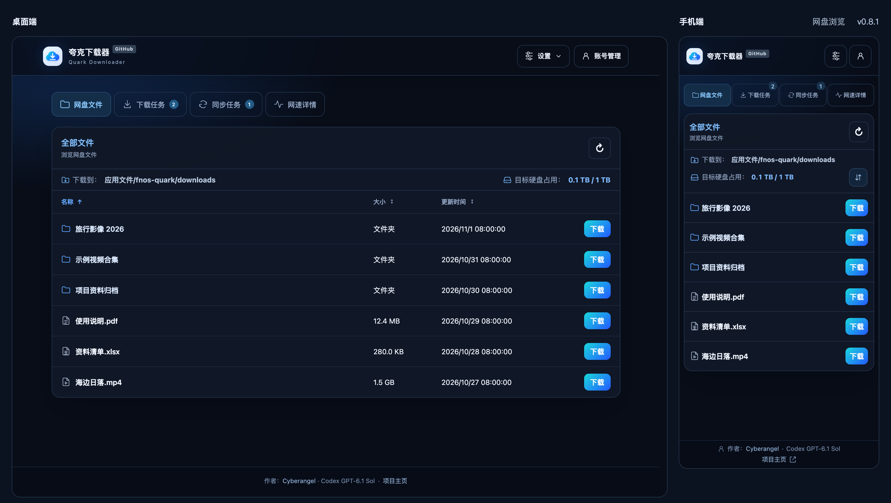
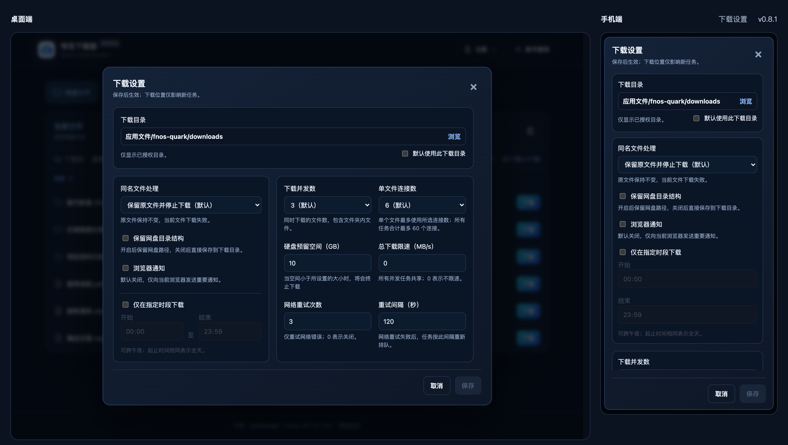
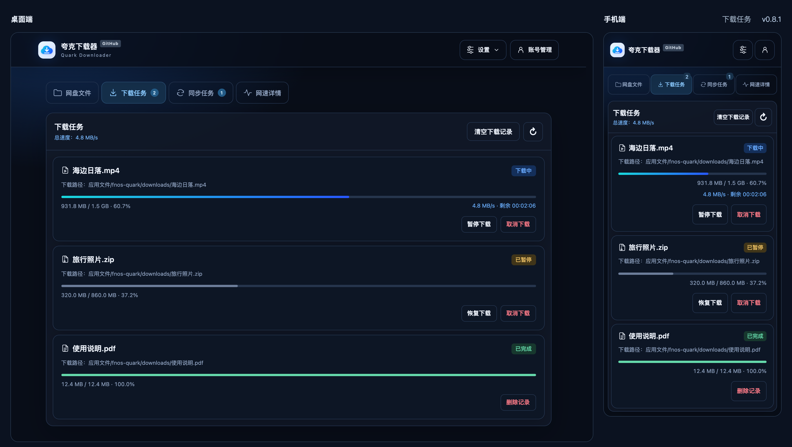
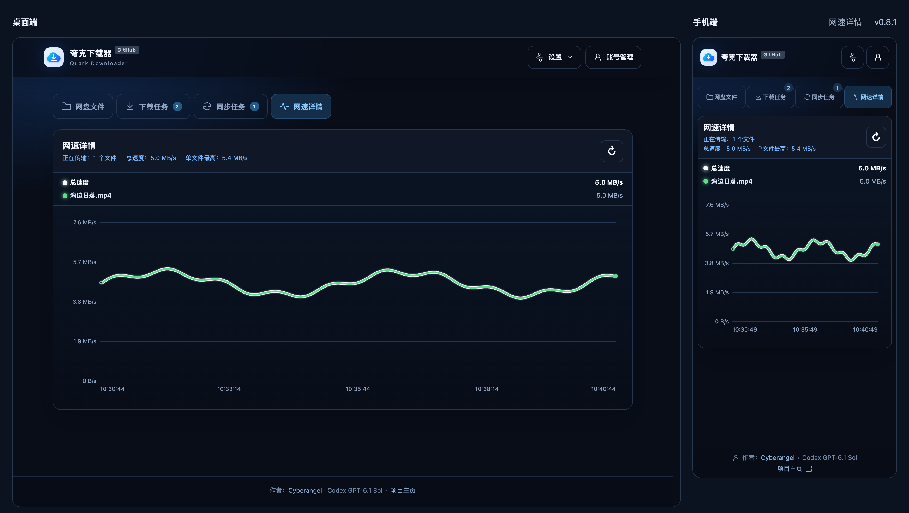
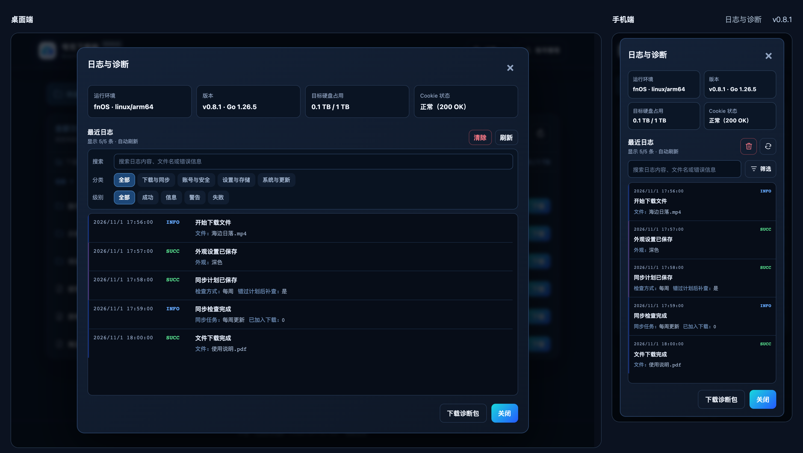

# 飞牛夸克下载器

面向 fnOS 的夸克网盘第三方下载器，通过网页浏览网盘，将文件下载到本地目录。最低支持 fnOS `1.1.8`。更名沿用原普通版的数据目录和升级入口。

> [!IMPORTANT]
> 本项目与夸克网盘及其运营方无隶属、合作或授权关系，不提供网盘限速破解、访问控制绕过或未授权访问。下载速度取决于夸克服务、账号权益和网络环境。为防止滥用，暂不提供 docker 版本。

> [!WARNING]
> 由于代码的历史遗留问题，v0.7.6 及之前的旧版本无法正常的更新至最新版本，请移步到飞牛应用中心卸载并手动安装最新版本。
> 卸载时保留“应用文件/fnos-quark”和其他下载目录；重新安装后会迁移保留下来的配置和任务。

## 下载

当前版本为 v0.8.1。下载见 [GitHub Releases](https://github.com/ElyDemiurge/fnOS-quark/releases/latest)。

| 架构 | 安装包 |
| --- | --- |
| x86_64 | `fnos-quark-0.8.1-x86_64.fpk` |
| ARM64 | `fnos-quark-0.8.1-arm64.fpk` |

对照 Release 的 `SHA256SUMS` 校验文件，不一致时重新下载：

```bash
sha256sum fnos-quark-0.8.1-x86_64.fpk
```

通过内置更新功能升级后，应用中心的版本号不会同步更新；以「设置」菜单底部显示的版本号为准。

## 主要功能

- 网盘浏览与排序，文件、文件夹下载和目录结构保留
- 扫码或 Cookie 登录，暂停、恢复、重试、优先下载和断点续传
- 增量同步，支持固定间隔、每天、每周和 Cron 计划
- 下载设置、预计剩余时间、速度曲线、浏览器通知、诊断导出和应用内更新
- 适配桌面与手机，支持跟随系统、浅色和深色外观



## 安装与首次使用

1. 在 fnOS“应用中心”手动安装对应架构的 FPK。
2. 打开应用并同意使用协议。在「访问令牌验证」窗口点「复制路径」，在 NAS 上按该路径以文本方式打开 `access_token_settings.json`。
3. 找到 `"token"`，只复制冒号后双引号里的内容，粘贴后点「验证并进入下载器」。令牌由下载器在首次启动时于本地随机生成，获取令牌**无需付费**。
4. 在“账号管理”中使用夸克网盘 App 扫码登录，或选择 Cookie 登录。

浏览器和飞牛 App 保存验证状态。第一次在另一台设备或另一个浏览器打开同一下载器时，输入同一个令牌即可。清除该站点的数据后也可用它重新验证；如果已修改令牌，请使用文件中的新值。

退出或 Cookie 失效会暂停任务，进度和记录保留；重新登录原账号可恢复，手动暂停的任务需自行恢复。

更换账号前，删除全部同步关系（含暂停、失效项），完成或取消其余下载，并删除未完成、失败及已取消的记录；已完成历史无需删除。

升级方式见 [Release 升级说明](https://github.com/ElyDemiurge/fnOS-quark/releases/latest)。

## 数据目录

```text
应用文件/fnos-quark/
├── config/       访问令牌、登录信息、外观、支持作者偏好和下载/同步设置
├── data/         任务、通知及运行状态
├── downloads/    默认下载文件
└── logs/         日志及崩溃报告
```

卸载时选择保留应用文件，确保卸载不删除上述数据。目录不可用或授权撤销后，恢复目录或授权再手动重试。

### 选择或添加下载目录

打开「设置 → 下载设置 → 浏览」。已保存的目录仍可用时，会直接打开该目录。点「授权目录」可查看全部已授权的文件夹，选好位置后点「选择当前目录」，再保存下载设置。

- **直接授权**　安装新版 FPK 后，在 fnOS 1.2.0401 及以上的飞牛入口，管理员可点「授权其他目录」并选择文件夹。从飞牛手机 App 打开时，还需 App 1.34.0 或更高版本。较早的受支持系统使用下面的应用设置方式。
- **只看到「刷新」**　展开「如何授权」，到「应用中心 → 夸克下载器 → 应用设置」为文件夹授予读写权限，再返回下载器点「刷新」。
- **从 v0.8.0 内置升级**　可以继续使用应用中心授权。若要启用「授权其他目录」，卸载时保留应用文件，再安装同一架构的新版普通版 FPK。

如果窗口提示「暂时无法读取完整的授权目录」，先点「刷新」重试。查询恢复后，新授权的文件夹才会出现在列表中。

## 下载设置

| 设置 | 说明 |
| --- | --- |
| 下载目录 | 已授权、可写的目录 |
| 默认使用此下载目录 | 默认不勾选 |
| 保留网盘目录结构 | 默认关闭 |
| 同名文件处理 | 默认保留原文件并停止下载；可选覆盖、保留二者或跳过 |
| 下载并发数 | 同时传输的文件数（含文件夹内文件），1–5，默认 3 |
| 单文件连接数 | 3、6、9、12，默认 6 |
| 硬盘预留空间 | 默认 10 GB |
| 总下载限速 | 所有任务共享；默认 0，不限速 |
| 指定下载时段 | 默认关闭，按下载器本地时间执行，支持跨午夜 |
| 网络错误自动重试 | 默认 3 次、间隔 120 秒；0 次关闭 |
| 浏览器通知 | 默认关闭；仅通知当前浏览器，须保持网页打开并授予通知权限；HTTP 页面可能不可用 |

在“设置 → 下载设置”选择已授权的目录或子目录。未勾选“默认使用此下载目录”时，每次下载单独选目录，不改变默认设置；取消不创建任务。

目录、目录结构和同名处理只影响新任务。



## 任务规则

- 关闭网页后下载仍会继续。文件夹任务可展开查看进度和失败原因。
- 暂停后可单独恢复子文件，或点击“恢复全部下载”；排队中的子文件可优先下载或取消。
- 取消单文件删除未完成的临时文件；取消文件夹可选择保留或删除已完成文件。
- 删除记录不删除已完成文件；清空仅处理已完成、失败和已取消的记录。



## 同步、网速与更新

### 增量同步

在“设置 → 同步设置”依次选择网盘文件夹、保存位置和执行计划。保存位置默认追加网盘文件夹名，可修改或留空；创建前确认最终路径。

| 检查方式 | 说明 |
| --- | --- |
| 固定间隔 | 默认每 60 分钟检查，可设为 1 分钟至 7 天 |
| 每天 / 每周 | 指定时间执行；每周可多选星期 |
| Cron | 五段“分 时 日 月 星期”；`0 22 * * 6` 表示每周六 22:00 |

计划按窗口显示的下载器时区执行，可预览接下来 3 次检查。首次同步可选创建后开始或等到计划时间；默认开启“错过计划后补查一次”，手动暂停时不执行。

- 首次下载已有内容，之后只下载识别为新增的内容，不更新旧文件。
- 云端删除不影响本地文件；本地文件移走或删除后需手动下载。
- 来源目录或上级目录移动、改名、删除后须重新建立同步。
- 删除同步任务取消未完成下载，保留已完成文件。

### 网速详情

显示最近 10 分钟的总速度和单文件曲线，重启清空速度历史。



### 应用更新

v0.7.7 及以后版本可在“设置 → 检查更新”查看说明并安装。更新包在关闭窗口后继续下载；换线前须取消并等待清理，失败后按提示重试。

- 线路支持自动选择、GitHub 直连、GH-Proxy 和自定义 HTTPS 代理，自动保存；自动选择失败后尝试其他线路。
- 自定义代理填写完整地址，离开输入框或按回车保存；清空并保存后恢复自动选择，切换线路会保留地址。
- “检测延迟”仅供选线参考。请选择可信代理：大小和 SHA-256 校验不能代替发布者签名，同一代理可能同时篡改安装包和校验信息；当前尚未验证发布者签名。

## 日志与诊断

在“设置 → 日志与诊断”搜索日志、按分类和级别筛选；手机端点击“筛选”。“清除”只清空网页日志，不删除日志文件。异常退出会保存崩溃报告并自动重启。



诊断包包含运行信息、更新线路和延迟检测结果、脱敏日志、通知和崩溃报告，以及外观、支持作者偏好和同步计划状态。导出只读取已有状态。不含 Cookie、访问令牌、自定义代理地址或下载文件内容，但可能含文件名和路径，分享前请检查。

## 外观与打赏

- **外观**：在「设置 → 外观设置」选择浅色、深色或跟随系统（默认）。设置自动保存并在浏览器间共享，重启后保留。
- **支持作者**：在“设置 → 支持作者”通过微信或支付宝自愿打赏。
- **鸣谢**：查看项目贡献者和开源组件。

## 常见问题

- **桌面打开后显示 502**：稍等后重试；仍失败时重启应用，查看 `应用文件/fnos-quark/logs/fnos-quark.log`。
- **应用无法启用**：查看应用日志；权限报错时恢复应用访问权限后重试，保留配置和任务文件。
- **访问令牌无效**：重新复制 `token`，去除引号和空白；可在“访问令牌设置”中调整。
- **如何使用 Cookie 登录**：登录 [夸克网盘](https://pan.quark.cn)，打开开发者工具“网络 / Network”并刷新；从发往 `drive.quark.cn` 的请求标头复制完整 `Cookie`（不是 `Set-Cookie`），粘贴到“Cookie 登录”并保存。
- **Cookie 已失效**：重新登录原账号，任务和进度保留。
- **暂停后暂时无法恢复**：稍等后刷新任务列表，再恢复下载。
- **下载速度与官方客户端不同**：检查总限速、账号权益和网络环境，可导出诊断包排查。
- **硬盘空间不足**：按提示释放空间或调整预留值后重试。

## 安全与使用规范

仅下载自己有权使用的文件，遵守夸克网盘服务条款、法律法规和网络服务规则，不侵犯版权或隐私，不批量抓取或共享凭据。

妥善保管 Cookie、访问令牌、配置和诊断包，不将应用端口直接暴露到公网；令牌验证仅在可信内网关闭。重要文件独立备份；出现账号风险或不明登录时，停止应用并更新凭据。

## 许可与作者

本软件为专有软件，仅允许个人使用作者发布且未经修改的 FPK。未经书面许可，不得修改、再发布或转售，不得用于收费、捆绑销售或商业服务。完整条款见 [LICENSE](LICENSE)。

作者：Cyberangel、Codex GPT-6.1 Sol

## Star History

<a href="https://www.star-history.com/?repos=elydemiurge%2Ffnos-quark&amp;type=date&amp;releases=&amp;legend=bottom-right">
  <picture>
    <source media="(prefers-color-scheme: dark)" srcset="https://api.star-history.com/chart?repos=elydemiurge%2Ffnos-quark&amp;type=date&amp;legend=bottom-right&amp;theme=dark" />
    
  </picture>
</a>
