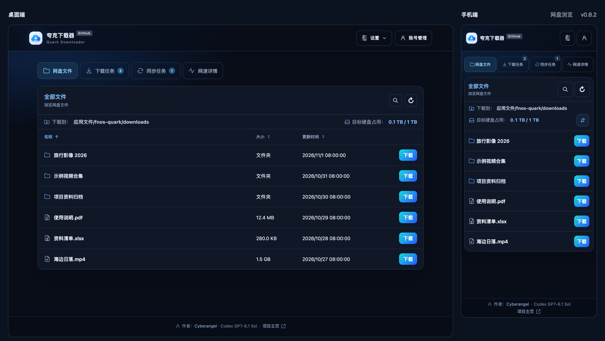
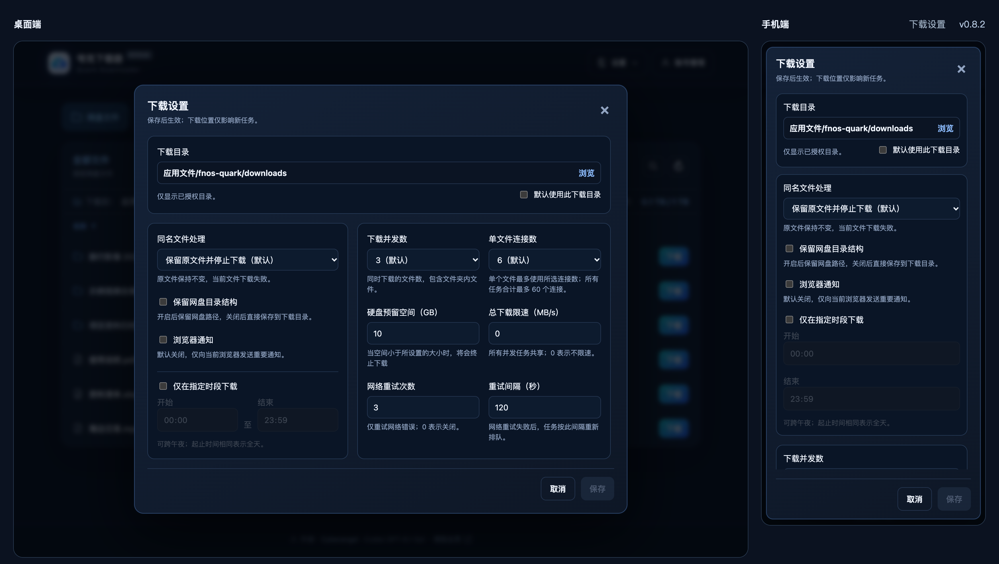
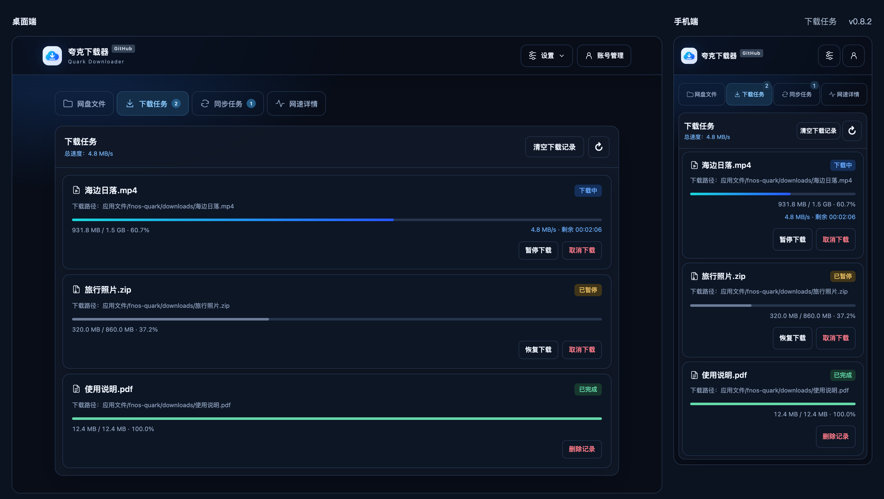
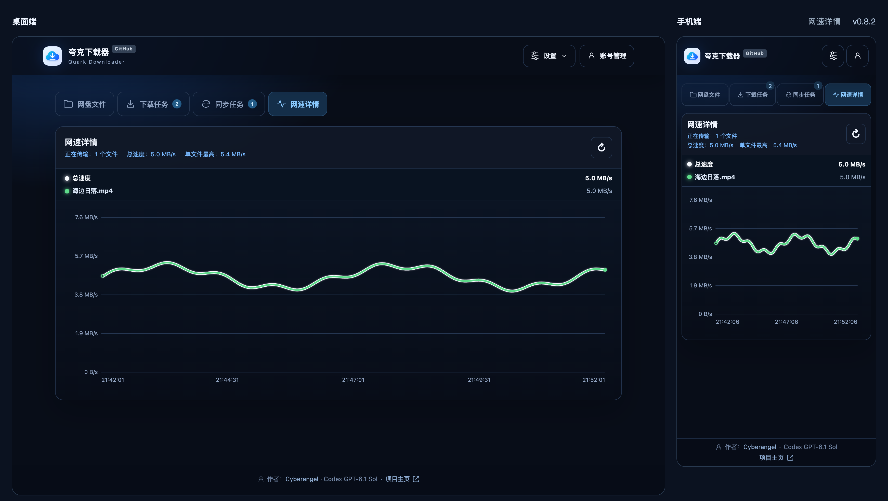
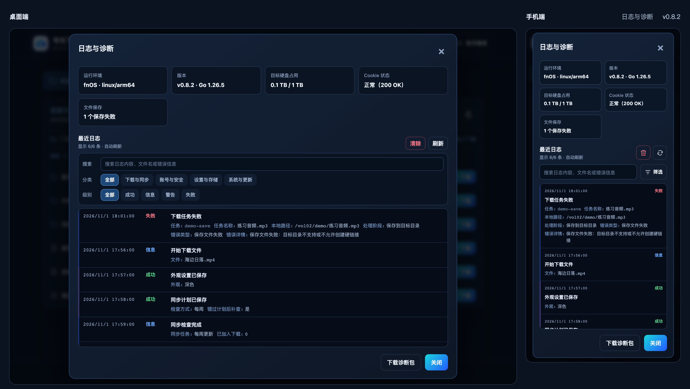

# 飞牛夸克下载器

面向 fnOS 的夸克网盘第三方下载器，通过网页浏览网盘，将文件下载到本地目录。最低支持 fnOS `1.1.8`。

> [!IMPORTANT]
> 本项目与夸克网盘及其运营方无隶属、合作或授权关系，不提供网盘限速破解、访问控制绕过或未授权访问。下载速度取决于夸克服务、账号权益和网络环境。为防止滥用，暂不提供 docker 版本。

> [!WARNING]
> v0.7.6 及之前的普通版请在应用中心手动重装。卸载时保留“应用文件/fnos-quark”和其他下载目录。

## 下载

夸克下载器已经上架飞牛官方，欢迎在 fnOS NAS 的应用中心中搜索“夸克下载器”安装。

手动安装时，按 NAS 架构下载对应的 FPK。[v0.8.2 普通版与升级说明](https://github.com/ElyDemiurge/fnOS-quark/releases/tag/v0.8.2)

| 架构 | 安装包 |
| --- | --- |
| x86_64 | `fnos-quark-0.8.2-x86_64.fpk` |
| ARM64 | `fnos-quark-0.8.2-arm64.fpk` |

手动安装前，计算所下载 FPK 的 SHA-256，与同一 Release 的 `SHA256SUMS` 中对应文件名的值核对。

通过内置更新功能升级后，应用中心的版本号不会同步更新；以「设置」菜单底部显示的版本号为准。

## 主要功能

- 网盘浏览与排序，文件、文件夹下载和目录结构保留
- 扫码或 Cookie 登录，暂停、恢复、重试、优先下载和断点续传
- 增量同步，支持固定间隔、每天、每周和 Cron 计划
- 下载设置、预计剩余时间、速度曲线、浏览器通知、诊断导出和应用内更新
- 适配桌面与手机，支持跟随系统、浅色和深色外观



### 网盘文件搜索

在「网盘文件」点放大镜。输入名称可查文件和文件夹，输入 `*.mp4` 可查所有 MP4 文件。点 `.*` 切换为正则表达式，此时用 `\.mp4$` 匹配同一扩展名。

从「全部文件」搜索整个网盘，从文件夹内默认搜索当前目录及子目录。手机上点「筛选」可调整范围和类型。点结果下方的路径可打开所在目录，再点「返回搜索结果」继续查找。

## 安装与首次使用

1. 若选择 GitHub 普通版，在 fnOS 应用中心手动安装下载的 FPK。
2. 打开应用并同意使用协议。在「访问令牌验证」窗口点「复制路径」。若按钮显示「已选中，请复制」，请用系统的「复制」操作。到 NAS 按该路径以文本方式打开令牌文件。普通版的位置是 `应用文件/fnos-quark/config/access_token_settings.json`。
3. 找到 `"token"`，只复制冒号后双引号里的内容，粘贴后点「验证并进入下载器」。令牌由下载器在首次启动时于本地随机生成，获取令牌**无需付费**。
4. 在“账号管理”中使用夸克网盘 App 扫码登录，或选择 Cookie 登录。

浏览器和飞牛 App 保存验证状态。第一次在另一台设备或另一个浏览器打开同一下载器时，输入同一个令牌即可。清除该站点的数据后也可用它重新验证；如果已修改令牌，请使用文件中的新值。

退出或 Cookie 失效会暂停任务，进度和记录保留；重新登录原账号可恢复，手动暂停的任务需自行恢复。

更换账号前，删除全部同步关系（含暂停、失效项），完成或取消其余下载，并删除未完成、失败及已取消的记录；已完成历史无需删除。

## 数据目录

```text
应用文件/fnos-quark/
├── config/       访问令牌、登录信息、外观、支持作者偏好和下载/同步设置
├── data/         任务、通知及运行状态
├── downloads/    默认下载文件
└── logs/         日志及崩溃报告
```

卸载时选择「保留应用文件」。目录不可用或授权撤销后，恢复目录或授权再手动重试。

### 选择或添加下载目录

打开「设置 → 下载设置 → 浏览」，从授权目录列表进入目标文件夹，点「选择当前目录」并保存。

- **直接授权**　安装新版 FPK 后，在 fnOS 1.2.0401 及以上的飞牛入口，管理员可点「授权其他目录」并选择文件夹。从飞牛手机 App 打开时，还需 App 1.34.0 或更高版本。
- **通过局域网 IP 直接访问，或只看到「刷新」**　展开「如何授权」，到「应用中心 → 夸克下载器 → 应用设置」为文件夹授予读写权限，再返回下载器点「刷新」。
- **安装的是 v0.8.0 或更早的 FPK**　仅在下载器内升级时，可继续使用应用中心授权。若要启用「授权其他目录」，请在支持的系统上保留应用文件，重装同一架构的新版普通版 FPK。

如果窗口提示「暂时无法读取完整的授权目录」，点「刷新」重新查询。

在 fnOS 1.2.0401 及以上完整安装 v0.8.2 FPK 后，挂载名称由飞牛提供。如果看到「远程挂载/挂载 ID」，就从该目录进入目标文件夹。旧系统、旧包仅内置升级或名称查询失败时，仍可能显示「存储空间」。显示名称不影响原有下载位置和目录授权。

## 下载设置

| 设置 | 说明 |
| --- | --- |
| 下载目录 | 已授权、可写的目录 |
| 默认使用此下载目录 | 默认不勾选 |
| 保留网盘目录结构 | 默认关闭 |
| 同名文件处理 | 默认保留原文件并停止下载；可选覆盖、保留二者或跳过 |
| 下载并发数 | 同时传输的文件数（含文件夹内文件），1–5，默认 3 |
| 单文件连接数 | 3、6、9、12，默认 6 |
| 硬盘预留空间 | 默认 10 GB |
| 总下载限速 | 所有任务共享；默认 0，不限速 |
| 指定下载时段 | 默认关闭，按下载器本地时间执行，支持跨午夜 |
| 网络错误自动重试 | 默认 3 次、间隔 120 秒。0 次关闭任务自动重试。服务器限流或暂时不可用时，按设置间隔和服务器指定时间中较长的一项等待。服务器指定时间最多计 24 小时。 |
| 浏览器通知 | 默认关闭；仅通知当前浏览器，须保持网页打开并授予通知权限；HTTP 页面可能不可用 |

未勾选「默认使用此下载目录」时，每次下载可单独选目录，点「下载到当前目录」开始，点「取消」不创建任务。目录、目录结构和同名处理只影响新任务。调整限速后，网速曲线可能稍后才稳定。



## 任务规则

- 关闭网页后下载仍会继续。文件夹任务可展开查看进度和失败原因。
- 名称上限为 255 个 UTF-8 字节，扩展名也计入。单文件因追加下载后缀超限时，任务显示「文件名过长」。按标题下第一行的字节数，在夸克网盘改短第二行列出的完整文件名，再重新创建任务。「日志与诊断」及导出的诊断包也会显示这两行提示。
- 改名后，若「下载任务」中已有失败的文件夹任务，点「重试」重新扫描。单文件任务或创建时就被拒绝的任务，请从「网盘文件」重新创建。
- 下载含历史同名子文件夹的目录时，会合并其内容。若不同网盘文件对应同一目标路径，任务会报告冲突并保留现有文件。
- 暂停后可单独恢复子文件，或点击“恢复全部下载”；排队中的子文件可优先下载或取消。
- 取消单文件删除未完成的临时文件；取消文件夹可选择保留或删除已完成文件。
- 删除记录不删除已完成文件；清空仅处理已完成、失败和已取消的记录。

下载结束后，在「下载任务」点右上角刷新，可检查文件是否还在原位置。同一账号每 30 秒最多检查一次。发现文件缺失或下载位置暂不可检查时，卡片右上角的「已完成」会换成相应提示，进度条保留下载完成时的进度。

| 本地操作 | 在任务卡上看到什么 |
| --- | --- |
| 移走单独下载的文件 | 「此文件已被删除」 |
| 移走整个下载好的文件夹 | 「此文件夹已被删除」 |
| 保留最外层文件夹，只移走其中部分已下载文件 | 「部分文件已被删除」，展开可按相对路径查看受影响的文件。 |
| 保留最外层文件夹，移走其中所有已下载文件 | 「所有文件已被删除」 |

「已被删除」表示在原保存位置找不到下载的内容。移动、改名和删除都会出现相应提示。把缺失的文件全部按原名和原大小放回原路径，下次检查确认后，卡片重新显示「已完成」。如果当时选择「保留本地文件并跳过」，放回该文件即可，它可以与网盘文件大小不同。

下载到共享目录时，若显示「下载位置暂不可检查」，先确认挂载和目录授权，再刷新。旧记录首次显示文件缺失时，也先确认 NAS 上看到的是原共享目录。挂载断开后，同名的空文件夹仍可能存在。



## 同步、网速与更新

### 增量同步

在“设置 → 同步设置”依次选择网盘文件夹、保存位置和执行计划。保存位置默认追加网盘文件夹名，可修改或留空；创建前确认最终路径。

| 检查方式 | 说明 |
| --- | --- |
| 固定间隔 | 默认每 60 分钟检查，可设为 1 分钟至 7 天 |
| 每天 / 每周 | 指定时间执行；每周可多选星期 |
| Cron | 五段“分 时 日 月 星期”；`0 22 * * 6` 表示每周六 22:00 |

计划按窗口显示的下载器时区执行，可预览接下来 3 次检查。首次同步可选创建后开始或等到计划时间；默认开启“错过计划后补查一次”，手动暂停时不执行。

- 首次下载已有内容，之后只下载识别为新增的内容，不更新旧文件。
- 云端删除不影响本地文件；本地文件移走或删除后需手动下载。
- 来源目录或上级目录移动、改名、删除后须重新建立同步。
- 删除同步任务取消未完成下载，保留已完成文件。

### 网速详情

显示最近 10 分钟的总速度和单文件曲线，重启清空速度历史。



### 应用更新

GitHub 普通版 v0.7.7 及以后版本可在“设置 → 检查更新”查看说明并安装。更新包在关闭窗口后继续下载；换线前须取消并等待清理，失败后按提示重试。[Release 升级说明](https://github.com/ElyDemiurge/fnOS-quark/releases/latest)

- 线路支持自动选择、GitHub 直连、GH-Proxy 和自定义 HTTPS 代理，自动保存；自动选择失败后尝试其他线路。
- 自定义代理填写完整地址，离开输入框或按回车保存；清空并保存后恢复自动选择，切换线路会保留地址。
- 「检测延迟」仅供选线参考。请使用可信代理。下载器会校验大小和 SHA-256，尚未验证发布者签名，同一代理可能同时替换安装包和校验值。

## 日志与诊断

打开「设置 → 日志与诊断」，可以用文件名或完整任务 ID 搜索日志、按分类和级别筛选。手机端点「筛选」展开选项。任务等待自动重试时，日志显示原因、重试时间和次数。刷新失败时页面保留已读日志，并标明上次成功刷新的时间。

“清除”只清空网页日志，不删除日志文件。异常退出会保存崩溃报告并自动重启。



点「下载诊断包」可导出运行信息、更新线路和延迟检测结果、脱敏日志、通知和崩溃报告。保留失败任务记录后，即使清除网页日志或重启，也能导出已记录的保存错误，或文件夹下载失败的步骤和路径。

在「最近日志」选择「下载与同步」，可查看文件缺失、恢复或下载位置暂不可检查的记录。导出的诊断包包含最近一次检查结果，子文件缺失时还可核对数量和相对路径。网页使用现行文案展示旧版的单项缺失事件，包内的历史日志保留记录时的原文。清除日志后，仍可从保留的任务记录导出当前账号最近一次检查发现的问题。

诊断包不含 Cookie、访问令牌、自定义代理地址或下载文件内容，但可能含文件名和路径，分享前请检查。

进度到 100% 后若提示保存失败，在「下载任务」查看出错的文件，恢复目录或授权再手动重试。有完整可用断点时会直接重试保存。挂载始终拒绝保存时，可改在 NAS 本地可写目录新建下载任务，完成后用飞牛文件管理复制过去。

## 外观与打赏

- **外观**：在「设置 → 外观设置」选择浅色、深色或跟随系统（默认）。设置自动保存并在浏览器间共享，重启后保留。
- 打开「设置 → 支持作者」，可自愿使用微信或支付宝打赏。
- **鸣谢**：查看项目贡献者和开源组件。

## 常见问题

- **桌面打开后显示 502**：稍等后重试；仍失败时重启应用，查看 `应用文件/fnos-quark/logs/fnos-quark.log`。
- **应用无法启用**：查看应用日志；权限报错时恢复应用访问权限后重试，保留配置和任务文件。
- **访问令牌无效**：重新复制 `token`，去除引号和空白；可在“访问令牌设置”中调整。
- **如何使用 Cookie 登录**：登录 [夸克网盘](https://pan.quark.cn)，打开开发者工具“网络 / Network”并刷新；从发往 `drive.quark.cn` 的请求标头复制完整 `Cookie`（不是 `Set-Cookie`），粘贴到“Cookie 登录”并保存。
- **Cookie 已失效**：重新登录原账号，任务和进度保留。
- **暂停后暂时无法恢复**：稍等后刷新任务列表，再恢复下载。
- **下载速度与官方客户端不同**：检查总限速、账号权益和网络环境，可导出诊断包排查。
- **硬盘空间不足**：按提示释放空间或调整预留值后重试。
- **启动后提示「同步状态保存失败」**：检查 `应用文件/fnos-quark/config/` 所在磁盘的可用空间，并确认应用可以写入该目录。恢复写入后重启应用，下载器会重新记录尚未保存的同步下载结果。

## 安全与使用规范

仅下载自己有权使用的文件，遵守夸克网盘服务条款、法律法规和网络服务规则，不侵犯版权或隐私，不批量抓取或共享凭据。

妥善保管 Cookie、访问令牌、配置和诊断包，不将应用端口直接暴露到公网；令牌验证仅在可信内网关闭。重要文件独立备份；出现账号风险或不明登录时，停止应用并更新凭据。

## 许可与作者

本软件为专有软件，仅允许个人使用作者发布且未经修改的 FPK。未经书面许可，不得修改、再发布或转售，不得用于收费、捆绑销售或商业服务。完整条款见 [LICENSE](LICENSE)。

作者：Cyberangel、Codex GPT-6.1 Sol

## Star History

<a href="https://www.star-history.com/?repos=elydemiurge%2Ffnos-quark&amp;type=date&amp;releases=&amp;legend=bottom-right">
  <picture>
    <source media="(prefers-color-scheme: dark)" srcset="https://api.star-history.com/chart?repos=elydemiurge%2Ffnos-quark&amp;type=date&amp;legend=bottom-right&amp;theme=dark" />
    
  </picture>
</a>
